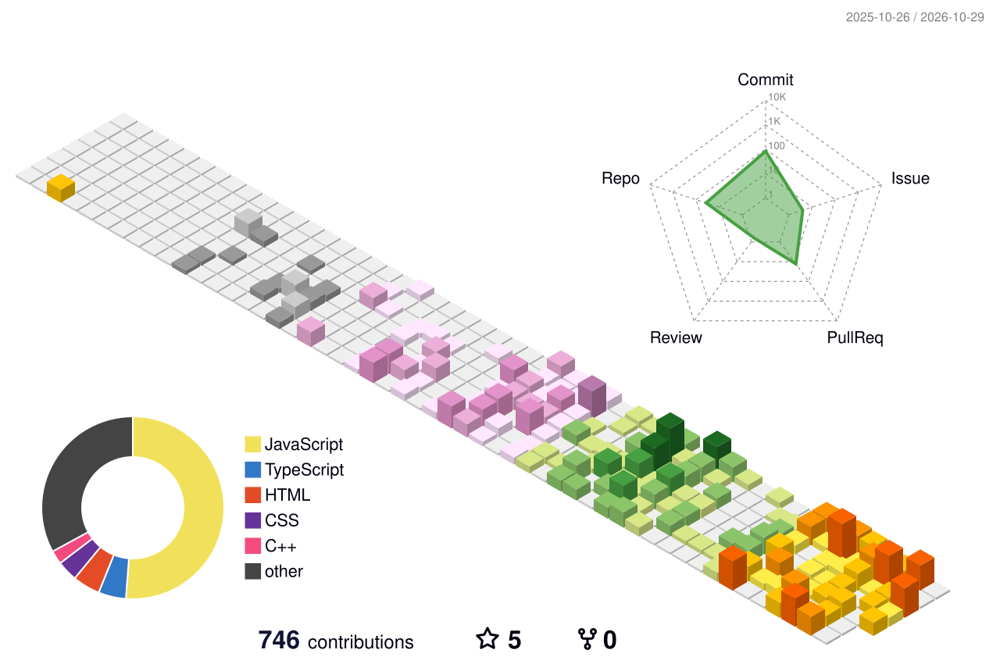

<!-- ===================================================== -->
<!--                    HEADER / INTRO                     -->
<!-- ===================================================== -->

# 👋 Hey, I'm Amrendra Sharma

### 🚀 Full-Stack Developer • Competitive Programmer • AI/ML Enthusiast

 

---

## 🧑‍💻 About Me

I'm a **Computer Science undergraduate at NIT Bhopal**, passionate about software development, problem solving, and emerging technologies.

I enjoy transforming ideas into **scalable, practical, and user-focused applications** while continuously improving my fundamentals in **Data Structures & Algorithms, System Design, and AI/ML**.

- 🎓 **CSE Undergraduate — NIT Bhopal** | Graduation Year: **2029**
- 💻 Full-Stack Developer
- 🧠 Competitive Programmer & DSA Enthusiast
- 🤖 Exploring Artificial Intelligence & Machine Learning
- 🚀 Interested in building impactful real-world products
- 🤝 Open to collaborations, internships, and interesting technical projects

---

## ⚡ Tech Stack

### 💻 Languages

### 🌐 Frontend

### ⚙️ Backend & Databases

### 🛠️ Tools & Technologies

---

## 📌 Featured Projects

📂 **Explore all my projects:**

---

# 🧠 Competitive Programming

> 💡 I regularly practice **Data Structures, Algorithms, problem solving, and competitive programming**.

---

# 📊 GitHub Analytics

 

---

# 📈 Contribution Activity

---

# 🧊 3D Contribution Calendar

---

# 🐍 Contribution Snake

---

# 🤝 Let's Connect

I'm always interested in:

- 💡 Collaborating on interesting projects
- 🚀 Building innovative products
- 🧠 Discussing DSA & software engineering
- 🤖 Exploring AI/ML ideas
- 💼 Internship & software development opportunities

---

### 💭 *"Build. Break. Learn. Improve. Repeat."*

⭐ **If you find my work interesting, consider starring my repositories!**

